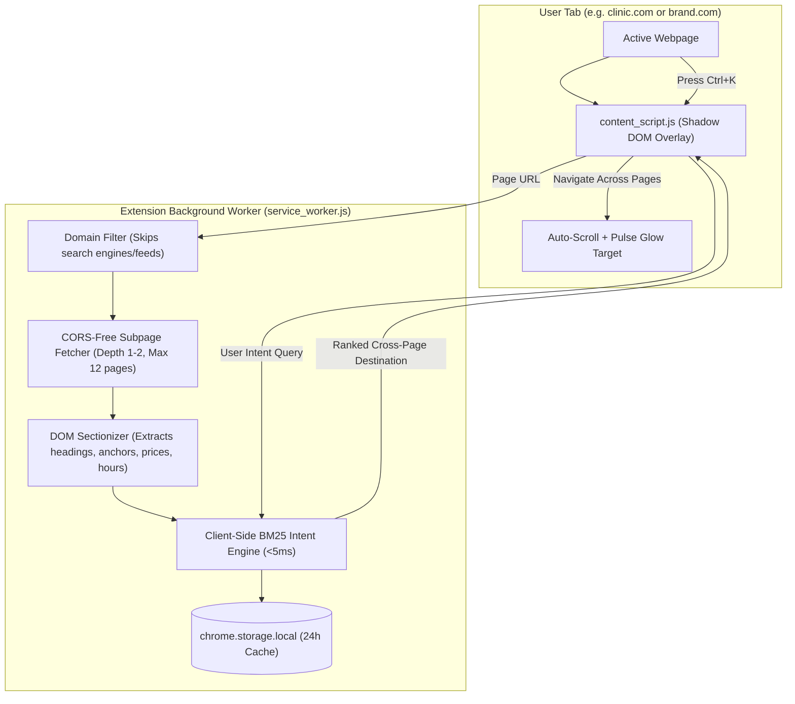

# Wayfindr ⚡

> **"Stop navigating websites. Tell them what you want."**

Wayfindr is a Chromium & Firefox browser extension that brings **intent-driven, cross-page navigation** to any website on the internet.

Instead of hunting through navigation bars, nested dropdowns, and deep hyperlinks, Wayfindr crawls and indexes the website's structure silently in the background. Press **`Ctrl+K`** (or `Cmd+K` on macOS) on any supported website, type what you're looking for, and Wayfindr instantly navigates and scrolls directly to the exact section with a pulse-highlight effect.

---

## 🌟 Key Capabilities

- ⚡ **Instant Intent Arrival (<10ms)**: Built-in client-side **BM25 lexical + intent ranking engine** running entirely in-browser.
- 🚀 **Cross-Page Hyperlink Navigation**: Silently crawls up to 10–12 internal subpages (doctors, pricing, specs, return policies, FAQs) in the background without affecting page load performance.
- 🔓 **CORS-Free Crawling**: Leverages browser extension background service worker host permissions to crawl internal pages without CORS restrictions.
- 🎨 **100% Shadow DOM Isolation**: The search palette runs in an isolated Shadow DOM container, guaranteeing zero styling or script conflicts with host websites.
- 📍 **Deep Landing & Pulse Highlighting**: Automatically carries anchors across pages, smoothly centering the target element and pulsing it with a clear glow effect.
- 🛡️ **Intelligent Filtering**: Automatically bypasses search engines (Google, Bing), video feeds (YouTube), social networks, and login portals.

---

## 📦 Architecture (Manifest V3)



---

## 🛠️ Installation & Testing (Developer Mode)

### In Chromium Browsers (Google Chrome / Brave / Edge / Opera):
1. Open your browser and navigate to:
   - Chrome: `chrome://extensions`
   - Brave: `brave://extensions`
   - Edge: `edge://extensions`
2. Enable **"Developer mode"** in the top right corner.
3. Click **"Load unpacked"**.
4. Select the `WarpWeb_Ext` folder:
   ```
   /home/Rurushu/Projects/WarpWeb_Ext
   ```
5. Wayfindr is now active!

### In Mozilla Firefox:
1. Open Firefox and navigate to `about:debugging#/runtime/this-firefox`.
2. Click **"Load Temporary Add-on..."**.
3. Select `manifest.json` inside the `WarpWeb_Ext` folder.
4. Wayfindr will load as an event-driven background script compatible with Firefox MV3.

---

## 🎮 How to Use

1. Open any content, business, clinic, university, or e-commerce website (e.g., our test hospital site at `http://localhost:3000/demo/apexcare/index.html` or audio store at `http://localhost:3000/demo/shoppulse/index.html`).
2. Press **`Alt+K`** or **`Ctrl+K`** (or **`Ctrl+Shift+K`** / **`Cmd+K`** on Mac).
3. Type what you want to find:
   - *"dr sharma timings"*
   - *"mri scan price"*
   - *"30 day returns"*
   - *"active noise cancelling specs"*
4. Press Enter or click the result: Wayfindr immediately transports you across pages, centers the target section, and pulses it.

---

## 💻 Development & Building

```bash
# Build TypeScript extension bundle
npm run build # or: node build.js
```

---

## 📄 License
MIT
