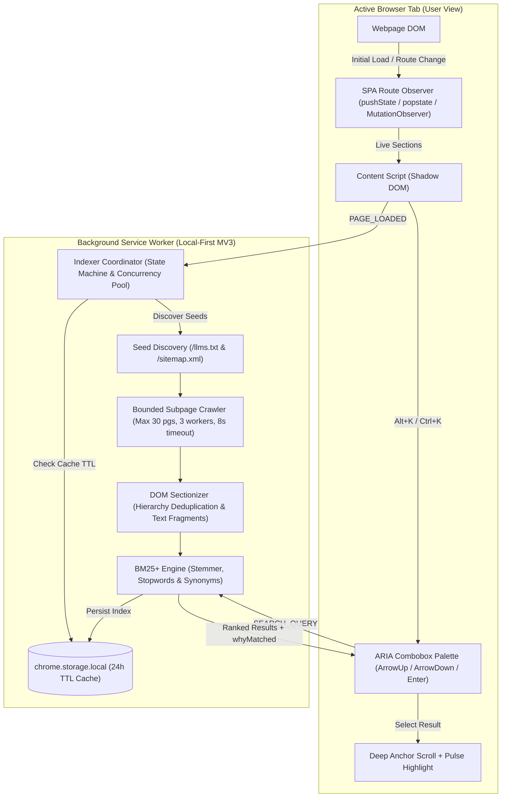

# Wayfindr ⚡

> **"Stop navigating websites. Tell them what you want."**

Wayfindr is a lightweight, local-first browser extension for Chromium and Mozilla Firefox (Manifest V3) that brings **intent-driven, cross-page navigation** to any website on the internet.

Instead of hunting through navigation bars, nested dropdowns, and deep hyperlinks, Wayfindr crawls and indexes the website's structure silently in the background. Press **`Alt+K`** (or `Ctrl+K`) on any supported website, type what you're looking for, and Wayfindr instantly navigates and scrolls directly to the exact section with a pulse-highlight effect.

---

## 🌟 Key Capabilities

- ⚡ **Instant Intent Arrival (<1ms)**: In-memory **BM25+ ranking engine** with Porter-like light stemming, stopword filtering, domain synonym expansion, and confidence thresholding.
- 🚀 **Bounded & Resource-Safe Crawling**: Proactively crawls up to **30 pages** (depth 2 on origin, depth 1 elsewhere) with bounded concurrency (3 workers), strict site caps (10MB site, 1MB page), per-request timeouts (8s), and `AbortController` cancellation.
- 🎯 **Hierarchy Deduplication & Deep Anchors**: Filters empty structural wrappers, extracts exact heading paths, and computes W3C Scroll-to-Text Fragments (`#:~:text=...`) when native anchor IDs are missing.
- 🔒 **Zero Remote Network Transmission**: 100% client-side local execution. No telemetry, no remote LLMs, no external APIs. Sensitive URLs (`/login`, `/checkout`, `/billing`, `/admin`) and password fields are automatically detected and excluded.
- 🎨 **W3C ARIA Combobox in Isolated Shadow DOM**: High-performance search palette runs in an isolated Shadow DOM container with full keyboard cycling (ArrowUp/ArrowDown/Enter/Escape), focus trap, and ARIA combobox/listbox attributes.
- 🔄 **Single Page Application (SPA) Support**: Detects client-side routing changes (`pushState`, `replaceState`, `popstate`) and dynamic DOM hydration via a debounced `MutationObserver`.

---

## ⌨️ Keyboard Shortcuts & Why Firefox Uses `Alt+K`

| Shortcut | Scope | Supported Browsers | Description |
| :--- | :--- | :--- | :--- |
| **`Alt+K`** *(Primary)* | Global Extension Command & DOM Capture | Chrome, Firefox, Brave, Edge | **Recommended shortcut.** Unconditionally opens the search palette across all browsers without conflicting with native browser shortcuts. |
| **`Ctrl+K`** / **`Cmd+K`** | In-Page DOM Capture Phase | Chrome, Brave, Edge, Opera | Works in Chromium browsers. |
| **Escape** | Modal Dialog | All | Closes the search palette and restores focus to the previously focused page element. |
| **ArrowDown / ArrowUp** | Combobox List | All | Navigates through search results with circular index wrapping. |
| **Enter** | Combobox List | All | Immediately navigates to the highlighted result. |

> [!NOTE]
> **Why Firefox uses `Alt+K`:**  
> Mozilla Firefox natively intercepts and binds `Ctrl+K` directly to its internal address bar / search engine shortcut at the browser chrome level, preventing web page content scripts from intercepting the event unless the user manually unbinds it. `Alt+K` is registered via the Manifest V3 `commands` API and direct capture-phase listeners to ensure reliable, zero-configuration invocation in Firefox and Chromium alike.

---

## 📦 System Architecture



---

## 🔄 Coordinator State Machine

The crawler lifecycle is managed by `IndexerCoordinator` to prevent duplicate crawls across tabs and handle service worker idling:

```
  ┌──────────────┐
  │  UNINDEXED   │ ──(Page load / Trigger)──> ┌─────────────┐
  └──────────────┘                            │  INDEXING   │
         ▲                                    └─────────────┘
         │                                           │
   (Clear index)                             (Crawl complete)
         │                                           │
         │                                           ▼
  ┌──────────────┐                            ┌─────────────┐
  │  REINDEXING  │ <──(TTL expires / Force)── │    READY    │
  └──────────────┘                            └─────────────┘
         │                                           │
         │ (Serve stale index during background crawl)
         └─────────────────> ┌───────────┐           │
                             │   STALE   │ <─────────┘
                             └───────────┘
```

1. **`UNINDEXED`**: Domain has not been visited or indexed. Crawl begins automatically upon page load.
2. **`INDEXING`**: Crawling subpages (bounded to 30 pages, depth 2/1). Multiple tabs on the same domain attach to the active crawl job without duplicating requests.
3. **`READY`**: BM25+ index built in memory and cached in `chrome.storage.local`. Search latency is sub-millisecond.
4. **`STALE`**: Cache TTL (24 hours) has elapsed. The stale index continues serving instant queries while a background refresh is queued.
5. **`REINDEXING`**: Active background refresh. Completed sections atomically replace outdated ones.

---

## 📊 Search Quality & Evaluation Benchmark

Wayfindr includes a standalone evaluation suite (`eval/run_eval.ts`) testing 126 ground-truth queries across three diverse website domains (Hospital Clinic, Audio E-Commerce, Developer Documentation):

| Metric | Pre-Improvement Baseline | Current Wayfindr (BM25+) | Delta |
| :--- | :--- | :--- | :--- |
| **Top-1 Accuracy (Exact Section)** | 56.86% | **90.20%** | **+33.34%** |
| **Top-1 Accuracy (Page-Level)** | 96.08% | **96.08%** | — |
| **Recall@5 (Exact Section)** | 90.20% | **97.06%** | **+6.86%** |
| **Recall@5 (Page-Level)** | 97.06% | **99.02%** | **+1.96%** |
| **MRR (Exact Section)** | 0.7328 | **0.9346** | **+0.2018** |
| **Synonym Top-1 Accuracy** | 44.40% | **83.30%** | **+38.90%** |
| **Synonym Recall@5** | 72.20% | **100.00%** | **+27.80%** |
| **Landing Success (Top-1 Anchor)** | 96.08% | **100.00%** | **+3.92%** |
| **False-Positive Rate on Negatives**| 33.33% | **25.00%** | **-8.33%** |
| **Query Latency (p50)** | 0.290 ms | **0.502 ms** | In-memory CPU |
| **Query Latency (p95)** | 0.810 ms | **1.157 ms** | Sub-2ms guarantee |

---

## 🌐 Browser Compatibility Matrix

| Feature | Chromium (Chrome, Brave, Edge, Opera) | Mozilla Firefox |
| :--- | :--- | :--- |
| **Manifest Version** | Manifest V3 | Manifest V3 |
| **Minimum Version** | 109+ | 109.0+ (`strict_min_version`) |
| **Background Model** | `background.service_worker` (IIFE bundle) | `background.scripts` (Event Page) |
| **Keyboard Command** | `Alt+K` and `Ctrl+K` | `Alt+K` (avoids address bar capture) |
| **Extension Storage** | `chrome.storage.local` (persistent) | `browser.storage.local` (persistent) |
| **DOM Isolation** | Shadow DOM (`mode: 'open'`) | Shadow DOM (`mode: 'open'`) |
| **Extension ID** | Auto-generated by browser | `wayfindr@ruru-devs.com` (`gecko.id`) |

---

## 🛠️ Build, Test & Run

### 1. Requirements
- Node.js >= 18.0.0
- npm >= 9.0.0

### 2. Installation & Build
```bash
# Clone the repository
git clone https://github.com/ruru-devs/Wayfindr.git
cd Wayfindr

# Install dependencies
npm install

# Build standalone distribution bundles (dist/background and dist/content)
npm run build

# Watch mode for active development
npm run watch
```

### 3. Run Automated Tests
```bash
# Run unit, security, crawler, and search quality test suite
npm test
```

### 4. Run Search Evaluation Harness
```bash
# Run 126-query ground truth evaluation harness
npm run eval
```

---

## 📥 Loading into Browsers (Developer Mode)

### Chromium (Google Chrome, Brave, Microsoft Edge, Opera)
1. Open your browser and navigate to:
   - Chrome: `chrome://extensions`
   - Brave: `brave://extensions`
   - Edge: `edge://extensions`
2. Enable **"Developer mode"** in the top right.
3. Click **"Load unpacked"**.
4. Select the root repository directory (containing `manifest.json`).
5. Open any website and press **`Alt+K`** or **`Ctrl+K`**.

### Mozilla Firefox
1. Open Firefox and navigate to `about:debugging#/runtime/this-firefox`.
2. Click **"Load Temporary Add-on..."**.
3. Select `manifest.json` in the root repository directory.
4. Open any website and press **`Alt+K`**.

---

## 🛡️ Privacy & Permissions

Wayfindr operates with a strict **zero remote transmission policy**. All indexing, BM25 scoring, and crawling remain 100% on your local machine.

For a full breakdown of data storage, auto-skipping on sensitive pages (passwords, checkout, banking), and permission model trade-offs, see [PRIVACY.md](PRIVACY.md).

---

## 📄 License
MIT © 2026 ruru-devs
